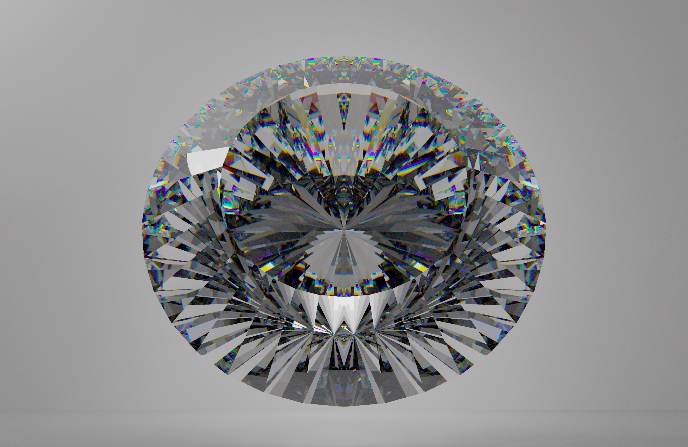

# Simple Path Tracer with C
## 簡述
這是一個簡單的專案，用 C 從 0 實現路徑追蹤。這個專案實現的項目包括但不限於
- BSDF
    - BRDF with GGX
    - BTDF with GGX
- 散射
- 光譜採樣
- NEE
- MIS

因此，你可以在這個簡單的路徑追蹤器裡面看到鑽石，如同圖片呈現的那樣 
這個專案完全是出於興趣所寫的，只想要在我的機器上跑起來而已，所以出了 bug 或者沒法在你的機器上跑起來別跑來問我，謝謝。

## 使用說明
### 構建
使用 `./makeMakefile.sh <檔案名稱> > Makefile` 創建一個 makefile，接著 `make all` 就好啦。

如果你和我一樣是 mac 使用者（系統：macOS Sequoia 15.7.9），請事先 `brew install sdl2-compat`，並確保 `sdl2-config` 可以正常運作。

如果你是 debian 系，例如 Ubuntu，的 linux user，請 `sudo apt install libsdl2-compat`，並確保 sdl2-config 可以正常運作。
其他 linux 發行版只要能裝上 sdl2 並且讓 `sdl2-config` 能夠正常運作應該就不會有什麼問題。

對於 Windows 使用者，我很抱歉，但 Windows 不遵守 POSIX 規範，因此多線程的部分完全無法通用，而且 make 工具和腳本都不能用。

如果你想要 renderToPictures，我有寫一個 toImg.py 幫助你把輸出檔案轉換成一個 .png 檔案。環境需求在 [requirements.txt](requirements.txt) 裡面。

### 坐標系
這個專案使用**右手坐標系**。視窗的左下角是原點，向右方是 +x 軸，向上方是 +y 軸，出螢幕側是 +z 軸。一個單位長對應現實中的 0.1 mm，在 macbook 上大約是一個像素的大小。

### Object
Object 是一道光線真正互動的對象。使用 `newObject(...)`  方法創建一個新的 Object。一個 Object 需要具有形狀 Shape 和介面 Interface (1.8.0)。

#### Shape
使用 `new<形狀>(...)` 獲得一個新的 shape。實現的 Shape 包括
- Triangle: 三角形以逆時針排序時看到的為正面
- Convex Polygon: 凸多邊形以逆時針排序時看到的為正面
- Sphere: 外側為正面
- Group: 可以組合多個 Shape 構成一個 group，正面按每個部件獨立計算

使用 destroyShape 這一個統一的函數釋放資源。

#### Interface
Interface 描述了兩個材質之間的關係。使用 `newInterface(in, out, roughness)` 產生一個介面。
- in: 裡面的材質
- out: 外面的材質
- roughness: 表面的粗糙度，介於 0 到 1 之間，越高表面越粗糙 

##### Texture
使用 `new<材質>(...)` 獲得一個新的材質。實現的 Texture 都在 [textures.h](src/textures.h) 裡面了。
部分可調整的參數如下：
- concentration：目前僅限藍寶石材質 Sapphire 才有，代表鐵、鈦離子的莫爾濃度，如果要貼近現實的話建議在 1e-3 到 1e-2 之間

你也可以像 [example.c](example.c) 一樣自己構建材質，只要指定材質內部的折射率、材質外部的折射率（一般來說是空氣）、粗糙度等就可以了。

### LightSource
使用 `newLightSource(...)` 獲得一個新的光源。這個函數需要光源的形狀以及光源在各個頻段的強度（預設在 [lightSource.c](src/lightSource.h) 裡面有不同色溫的黑體輻射光譜強度）。
1.7 版本追記：只有 sphere 可以被用在 LightSource 中，因為我只有實作 sphere 的表面法向量、PDF 等函數且 MIS 需要這兩者。

如果你不喜歡預設的強度也可以像 [example.c](example.c) 裡面一樣創建一個新的光譜函數。

### Camera
目前我只實現了類似針孔成像的相機（在數學上是等價的）。
原理是有一個觀察者的點，以及一個傳感器，透過該點觀察到的事情會被記錄到傳感器上的一點，再透過該傳感器映射到螢幕上。

預設的 `newRegularCamera` 提供將傳感器 `([startx, endx], [starty, endy], z)` 映射到螢幕 `([0, width], [0, height])` 上，而觀察者在傳感器後方 `depth` 的位置。

### render
在 [pathTracing.h](include/pathTracing.h) 裡面有兩個函式。

#### renderToWindow

```c
void renderToWindow(
    const char *windowTitle,
    Object **objects,
    LightSource **sources,
    Camera *camera,
    int width,
    int height,
    int threadCount)
```

這個函式會開啟一個視窗渲染。
- `windowTitle`: 視窗的名稱
- `objects`: 一個動態陣列（定義於 [dynamicArray.h](src/dynamicArray.h) 裡面），裡面是要渲染的所有 object
- `sources`: 一個動態陣列，裡面是場景內所有的光源
- `width`: 視窗（虛擬螢幕）的寬度
- `height`: 視窗（虛擬螢幕）的高度
- `threadCount`: 要用幾個線程渲染

#### renderToPictures
這個函式不會開啟任何視窗，但是在開始執行後你可以輸入
- p: 輸出一個像素檔案，透過 [toImg.py](toImg.py) 可以將其轉換成 png
- q: 停止執行程式並退出

參數部分
```c
void renderToPictures(
    const char *outputPath,
    Object **objects,
    LightSource **sources,
    Camera *camera,
    int width,
    int height,
    int threadCount)
```
`outputPath` 是指輸出檔案的名稱，剩下參數同 `renderToWindow`。